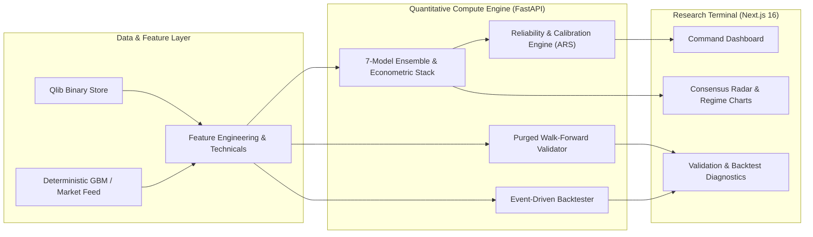

<div align="center">

# ASHEN-VECTOR

**Institutional Quantitative Market Intelligence & Multi-Model Research Terminal**

[](https://github.com/m4n1kya/ASHEN-VECTOR)
[](https://www.python.org/)
[](https://fastapi.tiangolo.com/)
[](https://nextjs.org/)
[](./LICENSE)

*Extract signal from noise through mathematical modeling, out-of-sample validation, and systematic experimentation.*

[Architecture](#system-architecture) • [Mathematical Stack](#quantitative--mathematical-model-stack) • [API Reference](#rest-api-reference) • [Quickstart](#getting-started) • [Documentation](./docs/README.md)

</div>

---

## Overview

**ASHEN-VECTOR** is a full-stack quantitative market intelligence platform and systematic research terminal built around Qlib-compatible market data infrastructure and a multi-model econometric & machine learning engine.

Designed around a two-level institutional workflow, ASHEN-VECTOR separates rapid situational awareness from deep mathematical inspection:

- **Level 1 — Command Dashboard (`/dashboard`)**: Immediate synthesis of instrument price action, directional probability, **Ashen Reliability Score (ARS)**, multi-model consensus radar, and Hidden Markov Model (HMM) regime probabilities.
- **Level 2 — Deep Quantitative Research (`/research`, `/models`, `/validation`, `/backtest`, `/risk`)**: Granular inspection of factor loadings, Ornstein-Uhlenbeck mean-reversion parameters, GARCH volatility forecasts, Purged Walk-Forward Cross-Validation folds, probability calibration curves, and transaction-cost-adjusted equity curves.

> **Core Engineering Principle:** *Every number has a methodology behind it.* All signals, probabilities, confidence intervals, and reliability scores are derived from mathematical and statistical models—never fabricated for visual appeal.

---

## Quantitative & Mathematical Model Stack

ASHEN-VECTOR evaluates each instrument across a heterogeneous stack of machine learning learners, econometric time-series models, and stochastic processes:

| Domain | Model / Methodology | Implementation Module | Key Outputs |
|---|---|---|---|
| **Gradient Boosting** | LightGBM & XGBoost Classifiers | `models/lightgbm_model.py`, `live_models.py` | Out-of-sample directional probability $P(\text{UP})$, feature importance |
| **Bagging Ensemble** | Random Forest Classifier | `models/random_forest.py`, `live_models.py` | Variance-reduced ensemble vote & signal strength |
| **Cross-Horizon Momentum** | Time-Series Z-Score Composite | `features/technical.py`, `live_models.py` | 5D, 21D, 63D, 126D, 252D & composite momentum Z-scores |
| **Mean Reversion** | Ornstein-Uhlenbeck Process | `api/services/live_models.py` | Long-term equilibrium $\mu$, reversion speed $\theta$, half-life (days), pressure |
| **Factor Attribution** | Fama-French 5-Factor Regression | `api/services/live_models.py` | Market ($\beta$), Size (SMB), Value (HML), RMW, CMA & annualized $\alpha$ |
| **Volatility Modeling** | GARCH(1,1) Conditional Variance | `api/services/live_models.py` | 1D, 5D, 21D expected volatility & volatility regime classification |
| **Time-Series Econometrics** | ARIMA Autoregressive Forecast | `api/services/live_models.py` | Multi-step conditional return projection |
| **Regime Detection** | Gaussian Hidden Markov Model (HMM) | `api/services/live_models.py` | Posterior state probabilities (`BULL`, `BEAR`, `HIGH VOL`, `LOW VOL`) |
| **Stochastic Simulation** | Geometric Brownian Motion Monte Carlo | `api/services/live_models.py` | $P(R > +10\%)$, $P(R > 0)$, $P(R < -10\%)$, median path return |
| **Evidence & Calibration** | Ashen Reliability Score (ARS) | `api/services/reliability_engine.py`, `calibration.py` | Composite 0–100 score across OOS ROC-AUC, Brier score, fold stability & Sharpe |

---

## System Architecture



### Repository Structure

```text
ASHEN-VECTOR/
├── src/ashen_vector/              # Core Python quantitative backend
│   ├── analytics/                 # Return, drawdown, Sharpe, Sortino & risk statistics
│   ├── api/                       # FastAPI application, REST routers, Pydantic schemas
│   │   ├── routes/                # health, instruments, stocks, live, models, training, validation, backtest
│   │   ├── schemas/               # Request/response contract definitions
│   │   └── services/              # LiveMarketService, LiveModelEngine, ReliabilityEngine, ValidationRunner
│   ├── backtesting/               # Event-driven backtest engine, portfolio, transaction costs, benchmarks
│   ├── config/                    # Environment-driven Pydantic settings
│   ├── core/                      # Domain exceptions & shared primitives
│   ├── data/                      # Qlib provider singleton & instrument resolution service
│   ├── features/                  # Leak-free technical indicators, feature pipeline & target engineering
│   ├── instruments/               # Ticker symbol resolver & metadata schemas
│   ├── models/                    # Base learners, LightGBM, Random Forest, calibration & registry
│   ├── predictions/               # Inference engine, confidence intervals & signal thresholds
│   └── services/                  # Instrument overview aggregation service
├── frontend/                      # Next.js 16 + TypeScript + Tailwind CSS + Recharts terminal
│   └── src/
│       ├── app/                   # App Router pages (/dashboard, /research, /models, /validation, /backtest, /risk)
│       ├── components/            # Navigation, SplashAnimation & validation diagnostic charts
│       └── lib/                   # Typed API client bindings
├── configs/                       # Model & pipeline YAML configurations
├── scripts/                       # Dataset inspection & CLI utilities
├── tests/                         # Unit & integration test suites (pytest)
├── docs/                          # 22 architectural & quantitative methodology specifications
├── Dockerfile                     # Production container image definition
├── docker-compose.yml             # Full-stack multi-container orchestration
├── Makefile                       # Developer workflow automation
└── pyproject.toml                 # Python package metadata & dependency specification
```

---

## Tech Stack

| Layer | Technologies |
|---|---|
| **Market Data & Analytics** | Microsoft Qlib, pandas, NumPy, SciPy, statsmodels |
| **Machine Learning** | scikit-learn, LightGBM, XGBoost, SHAP |
| **Backend API** | Python 3.12+, FastAPI, Pydantic v2, Uvicorn |
| **Frontend Terminal** | Next.js 16 (App Router), React 19, TypeScript, Tailwind CSS v4, Recharts, Lucide |
| **Quality & DevOps** | Pytest, Docker, Docker Compose, GitHub Actions CI |

---

## Getting Started

### Prerequisites

- **Python** `3.12+`
- **Node.js** `20+` and `npm`
- *(Optional)* Pre-initialized **Qlib binary dataset** (`qlib_bin`) for local historical exchange data

### 1. Clone & Configure Environment

```bash
git clone https://github.com/m4n1kya/ASHEN-VECTOR.git
cd ASHEN-VECTOR
cp .env.example .env
```

Environment variables in `.env`:

| Variable | Description | Default |
|---|---|---|
| `QLIB_PROVIDER_URI` | Path to Qlib binary dataset | `../qlib/qlib_bin` |
| `QLIB_REGION` | Market region (`us` or `cn`) | `us` |
| `API_HOST` | FastAPI bind address | `127.0.0.1` |
| `API_PORT` | FastAPI port | `8000` |

### 2. Backend Setup

```bash
# Create and activate virtual environment
python -m venv .venv
# Windows:
.venv\Scripts\activate
# macOS / Linux:
source .venv/bin/activate

# Install backend, ML, and development dependencies
pip install -e ".[dev,ml]"

# Launch the FastAPI server (http://127.0.0.1:8000)
PYTHONPATH=src python -m uvicorn ashen_vector.api.main:app --host 127.0.0.1 --port 8000 --reload
```

Interactive OpenAPI documentation is available at `http://127.0.0.1:8000/docs`.

### 3. Frontend Terminal Setup

```bash
cd frontend
npm install
npm run dev
```

Open **`http://localhost:3000`** in your browser to launch the ASHEN-VECTOR terminal.

### 4. Docker Compose (Full Stack)

```bash
docker compose up --build -d
```

---

## REST API Reference

| Method | Endpoint | Description |
|---|---|---|
| `GET` | `/api/health` | System, data provider, and model registry health status |
| `GET` | `/api/instruments` | Search and list available market instruments |
| `GET` | `/api/instruments/{symbol}` | Resolve instrument metadata and date coverage |
| `GET` | `/api/stocks/{symbol}/overview` | Comprehensive stock snapshot (market, performance, technicals, risk, factors) |
| `GET` | `/api/stocks/{symbol}/history` | Historical OHLCV series with configurable date bounds |
| `POST` | `/api/live/analyze` | Execute full 7-model quantitative ensemble, math stack & ARS reliability analysis |
| `GET` | `/api/predictions/{symbol}` | Retrieve calibrated directional prediction and confidence metrics |
| `GET` | `/api/models` | List registered ML models and validation metrics |
| `POST` | `/api/training/run` | Trigger model training and walk-forward evaluation pipeline |
| `POST` | `/api/validation/run` | Launch asynchronous out-of-sample Purged Walk-Forward Validation job |
| `GET` | `/api/validation/jobs/{job_id}/results` | Retrieve OOS validation metrics, calibration curve, fold stability & verdict |
| `POST` | `/api/backtest` | Launch event-driven strategy backtest with realistic slippage & commission costs |

---

## Testing & Verification

Run the unit and market pipeline test suite via `pytest`:

```bash
# Run unit and live market pipeline verification (21 tests)
PYTHONPATH=src pytest tests/unit tests/test_live_market.py -v

# Run full test suite (requires initialized Qlib dataset for integration tests)
PYTHONPATH=src pytest tests/ -v
```

---

## Technical Documentation

Detailed architectural specifications and mathematical derivations are maintained in the [`docs/`](./docs/README.md) directory:

- [**System Architecture**](./docs/system_architecture.md) • [**API Reference**](./docs/api_reference.md) • [**Deployment Architecture**](./docs/deployment_architecture.md)
- [**Quantitative Research Methodology**](./docs/quantitative_research_methodology.md) • [**Machine Learning Pipeline**](./docs/machine_learning_pipeline.md) • [**Model Evaluation & Validation**](./docs/model_evaluation.md)
- [**Event-Driven Backtesting Engine**](./docs/backtesting_engine.md) • [**Risk Management Framework**](./docs/risk_framework.md) • [**Portfolio Optimization**](./docs/portfolio_optimization.md)
- [**Data Engineering Pipeline**](./docs/data_engineering.md) • [**Market Data Pipeline**](./docs/market_data_pipeline.md) • [**UI/UX Design System**](./docs/ui_ux_design_system.md)

---

## Disclaimer

ASHEN-VECTOR is a quantitative research and analytical software platform. All model outputs, probabilities, factor scores, and backtest simulations are mathematical estimates derived from historical and simulated data and do **not** constitute financial or investment advice.

---

## License

Released under the [MIT License](./LICENSE).
